# Catalogizer Sequence Diagrams

Mermaid sequence diagrams for the key operational flows in the Catalogizer system.

## Rendered SVG Diagrams

| Diagram | SVG |
|---------|-----|
| Login Flow |  |
| Authenticated Request |  |
| Token Refresh |  |
| Full Scan |  |
| Media Detection |  |
| WebSocket Events |  |
| SSE Events |  |
| Subtitle Search/Download |  |
| Subtitle Sync |  |
| Subtitle Lifecycle |  |
| Admin System Info | *not generated yet: Admin System Info* |
| Lazy Provider Search | *not generated yet: Lazy Provider Search* |
| Non-Blocking Health Check | *not generated yet: Non-Blocking Health Check* |

## Table of Contents

- [Authentication Flow](#authentication-flow)
- [File Scanning Flow](#file-scanning-flow)
- [Media Detection Pipeline](#media-detection-pipeline)
- [WebSocket Real-Time Updates](#websocket-real-time-updates)
- [Subtitle Management Flow](#subtitle-management-flow)
- [Admin System Info Flow](#admin-system-info-flow)
- [Lazy Provider Search Flow](#lazy-provider-search-flow)
- [Non-Blocking Health Check Flow](#non-blocking-health-check-flow)

---

## Authentication Flow

### Login with JWT Token

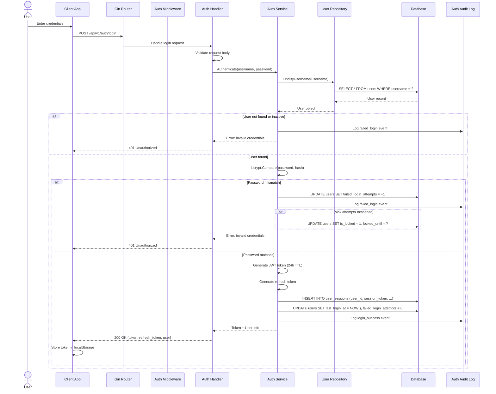

### Authenticated Request Flow

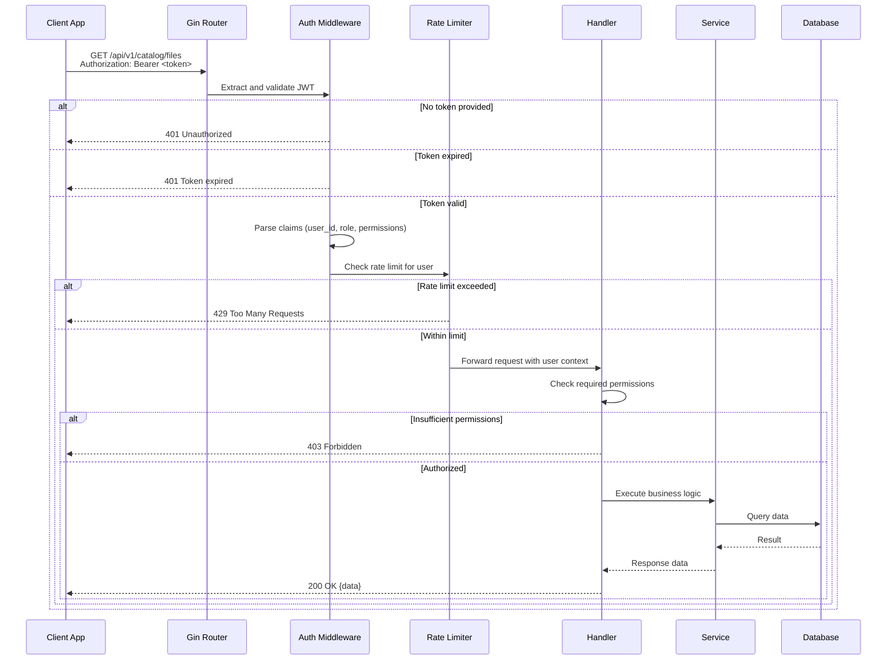

### Token Refresh Flow

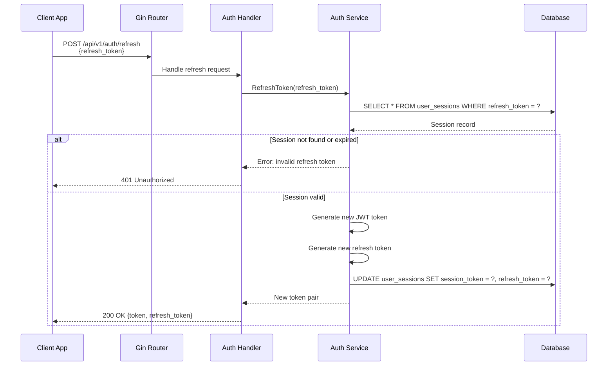

---

## File Scanning Flow

### Full Scan Operation

```mermaid
sequenceDiagram
    participant Admin as Admin User
    participant API as Catalog API
    participant Scanner as Scanner Service
    participant FSClient as Filesystem Client
    participant Factory as Client Factory
    participant Protocol as Protocol Client<br/>(SMB/FTP/NFS/WebDAV/Local)
    participant DB as Database
    participant EventBus as Event Bus

    Admin->>API: POST /api/v1/catalog/scan {storage_root_id}
    API->>Scanner: StartScan(storage_root_id, "full")

    Scanner->>DB: SELECT * FROM storage_roots WHERE id = ?
    DB-->>Scanner: Storage root config

    Scanner->>DB: INSERT INTO scan_history (storage_root_id, scan_type, status, start_time)
    DB-->>Scanner: scan_id

    Scanner->>Factory: CreateClient(protocol, config)
    Factory-->>Scanner: Protocol-specific client

    Scanner->>Protocol: Connect()
    alt Connection failed
        Scanner->>DB: UPDATE scan_history SET status = 'failed', error_message = ?
        Scanner->>EventBus: Publish(scan_failed event)
        Scanner-->>API: Error: connection failed
        API-->>Admin: 500 Scan failed
    else Connected
        Scanner-->>API: 202 Accepted {scan_id}
        API-->>Admin: Scan started

        loop For each directory (BFS up to max_depth)
            Scanner->>Protocol: ListDirectory(path)
            Protocol-->>Scanner: File entries

            loop For each file entry
                Scanner->>DB: SELECT id FROM files WHERE storage_root_id = ? AND path = ?

                alt File exists in DB
                    Scanner->>Scanner: Compare modification time and size
                    alt Changed
                        Scanner->>DB: UPDATE files SET modified_at = ?, size = ?
                        Scanner->>Scanner: Increment files_updated counter
                    else Unchanged
                        Scanner->>DB: UPDATE files SET last_scan_at = NOW()
                    end
                else New file
                    Scanner->>Scanner: Detect MIME type and file_type
                    Scanner->>DB: INSERT INTO files (storage_root_id, path, name, ...)
                    Scanner->>Scanner: Increment files_added counter

                    opt enable_metadata_extraction
                        Scanner->>Protocol: ReadFileMetadata(path)
                        Protocol-->>Scanner: Metadata
                        Scanner->>DB: INSERT INTO file_metadata (file_id, key, value)
                    end

                    opt enable_duplicate_detection
                        Scanner->>Protocol: ReadPartialFile(path, first_64KB)
                        Protocol-->>Scanner: File bytes
                        Scanner->>Scanner: Compute quick_hash
                        Scanner->>DB: SELECT id FROM files WHERE quick_hash = ?
                        alt Duplicate found
                            Scanner->>DB: UPDATE files SET is_duplicate = 1, duplicate_group_id = ?
                        end
                    end
                end

                Scanner->>EventBus: Publish(file_discovered event)
            end
        end

        Scanner->>Scanner: Detect deleted files (not seen this scan)
        Scanner->>DB: UPDATE files SET deleted = 1, deleted_at = NOW() WHERE last_scan_at < scan_start

        Scanner->>DB: UPDATE scan_history SET status = 'completed', end_time = NOW(), files_processed = ?, ...
        Scanner->>DB: UPDATE storage_roots SET last_scan_at = NOW()
        Scanner->>EventBus: Publish(scan_completed event)
    end
```

---

## Media Detection Pipeline

### Content Detection and Metadata Enrichment

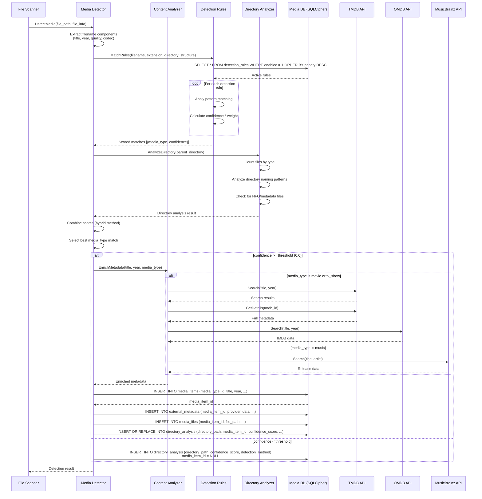

---

## WebSocket Real-Time Updates

### Real-Time Event Broadcasting

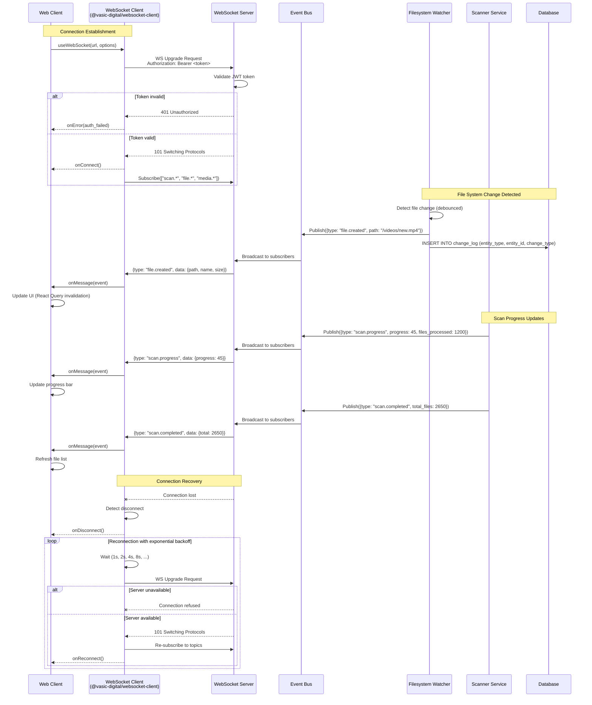

### SSE (Server-Sent Events) Alternative

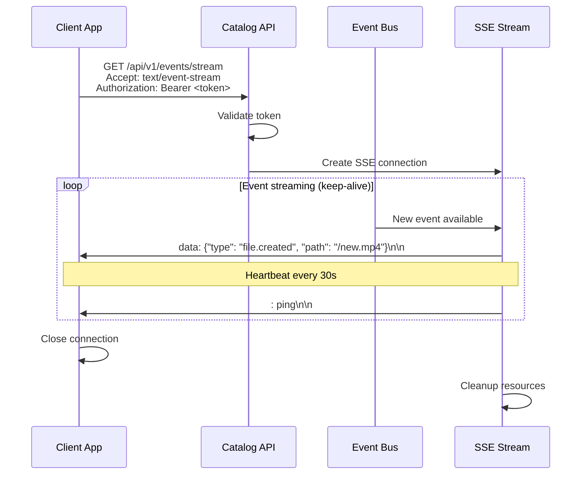

---

## Subtitle Management Flow

### Search and Download Subtitles

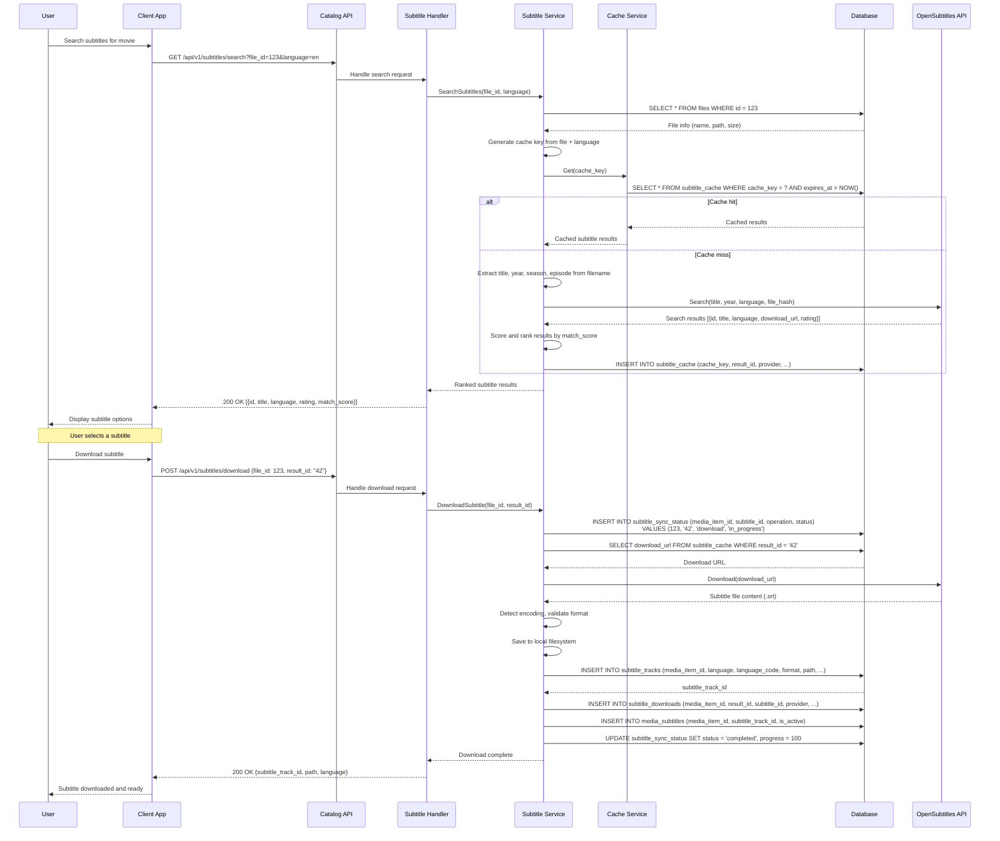

### Subtitle Sync Verification

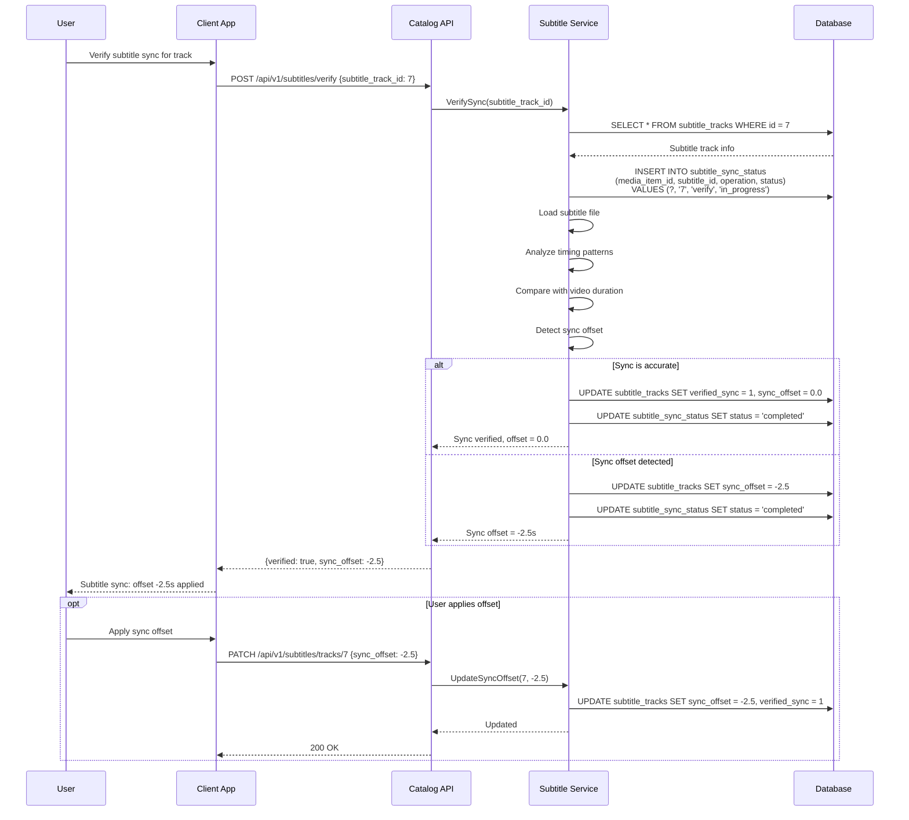

### Subtitle Lifecycle

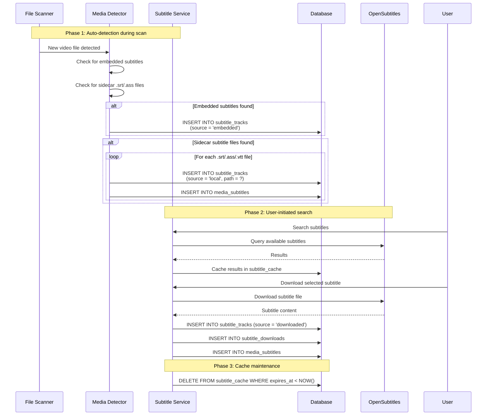

---

## Admin System Info Flow

### Admin System Information Request

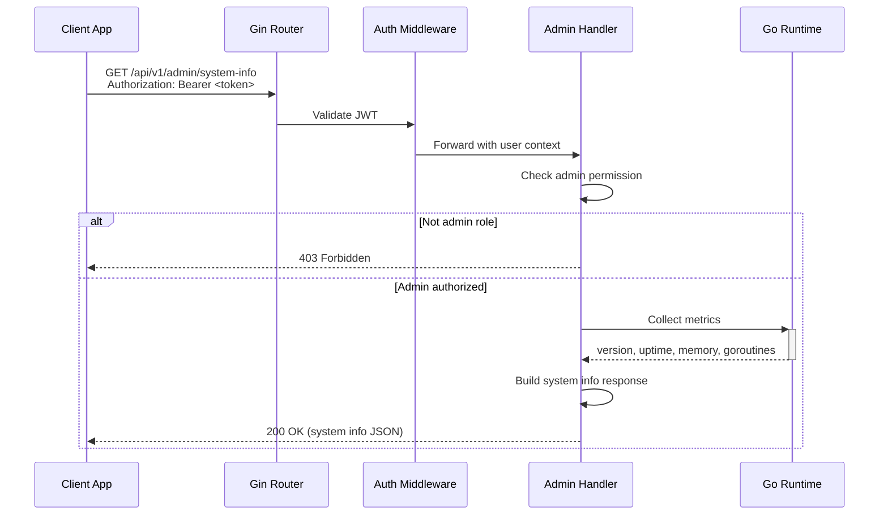

---

## Lazy Provider Search Flow

### Concurrent Provider Search with BoundedSemaphore

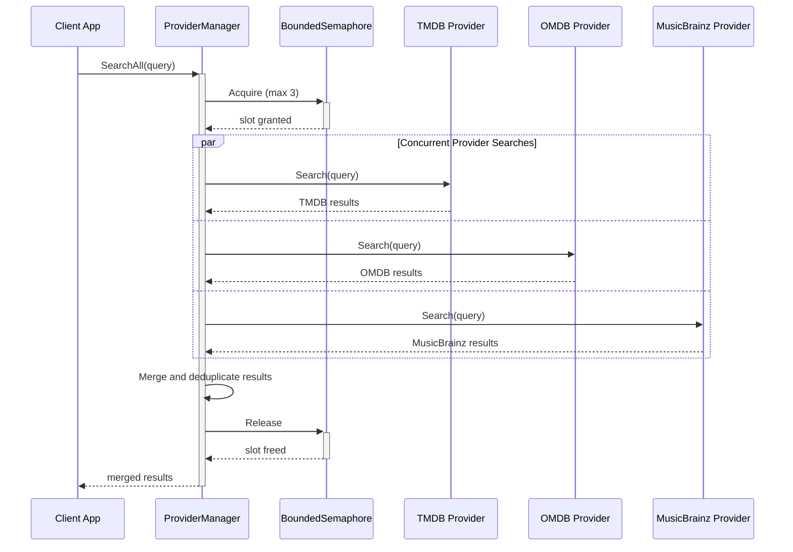

---

## Non-Blocking Health Check Flow

### Deep Health Check with Timeout

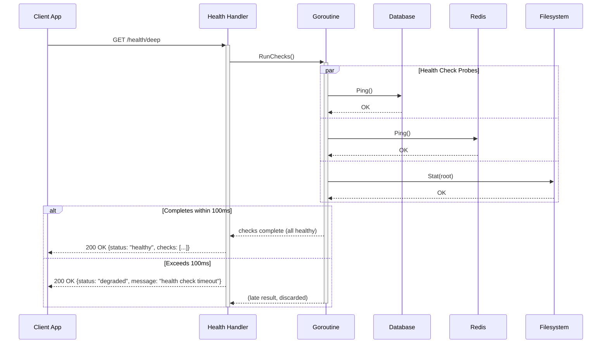
